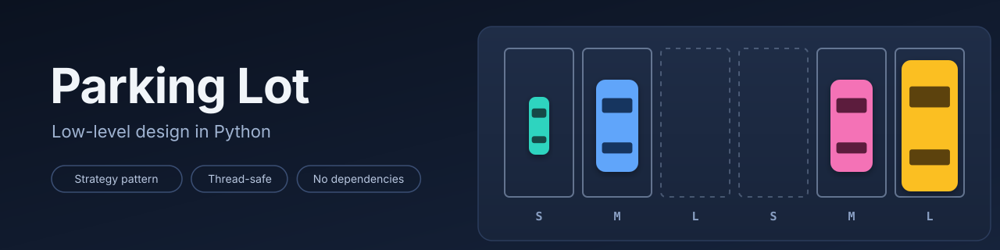
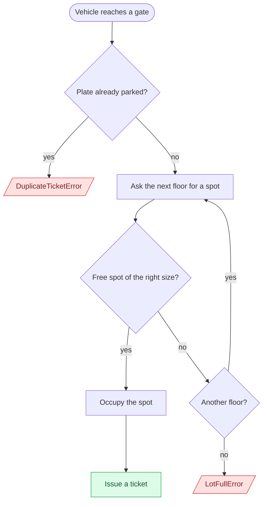
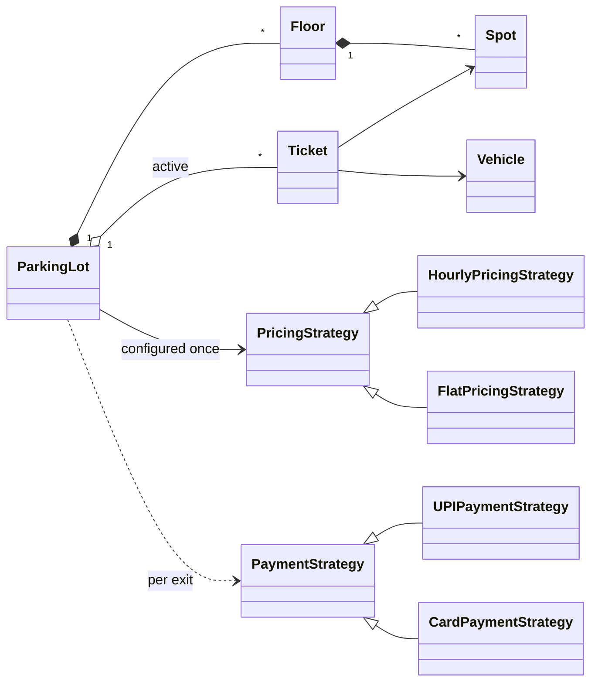
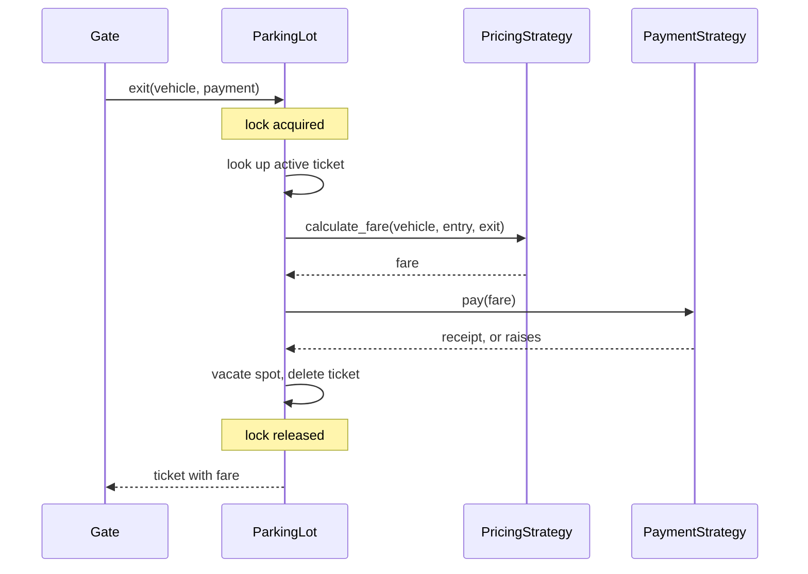
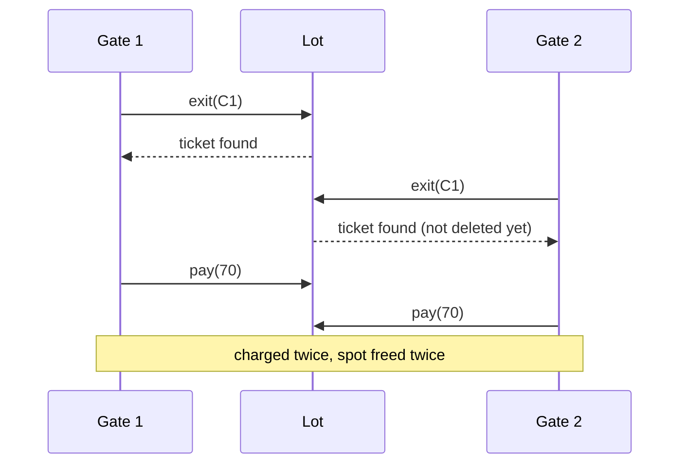
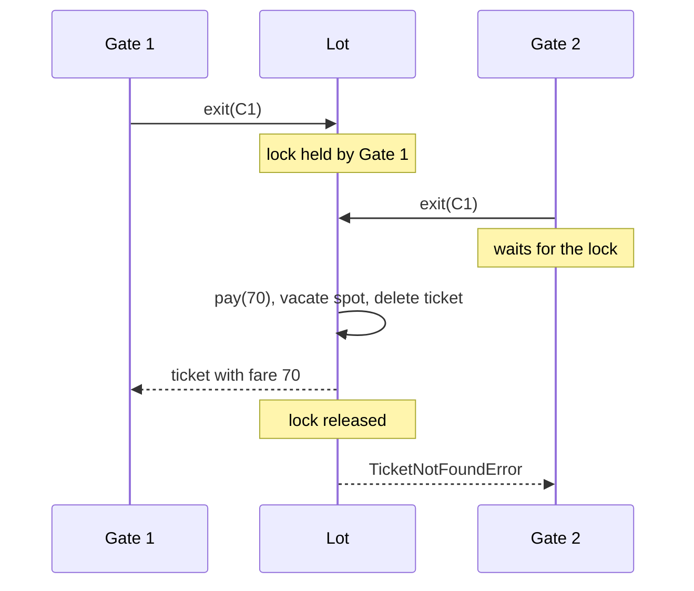

<p align="center"></p>

A multi-floor parking lot with swappable pricing and payment rules, safe to use from several gates at once. Python 3.9+, standard library only.

The project is a low-level design exercise. The aim was a small model where each class has one job, new rules arrive as new classes instead of edits, and the concurrent paths are correct and tested.

## Usage

```python
from parking_lot import Floor, ParkingLot, Size, Spot, Vehicle, VehicleType
from parking_lot.strategies.pricing import HourlyPricingStrategy
from parking_lot.strategies.payment import UPIPaymentStrategy

lot = ParkingLot(
    floors=[Floor(1, [Spot("1-A", Size.SMALL), Spot("1-B", Size.MEDIUM), Spot("1-C", Size.LARGE)])],
    pricing_strategy=HourlyPricingStrategy(),
)
car = Vehicle("KA01AB1234", VehicleType.CAR)

ticket = lot.park("gate-1", car)                  # ticket.spot.id == "1-B"
ticket = lot.exit(car, UPIPaymentStrategy())      # ticket.fare == 70
```

`park` raises `LotFullError` when no spot of the right size is free and `DuplicateTicketError` if the plate is already inside. `exit` raises `TicketNotFoundError` for a vehicle that is not parked.

## Requirements

| | Requirement | Status |
|---|---|---|
| 1 | Floors hold small, medium and large spots; a bike, car or bus needs a spot of its own size | Done |
| 2 | Entry issues a ticket and assigns a spot; if nothing fits, entry is refused | Done |
| 3 | Exit charges by duration at a rate per vehicle type, then frees the spot | Done |
| 4 | Several gates may enter and exit at the same time | Done |
| 5 | Live availability per floor and spot size | Not yet implemented |
| 6 | Pricing rules and payment methods can change without touching the lot | Done |

## Design

A lot has floors, a floor has spots, and each object answers questions about its own data and asks the object it owns for the rest. Parking a car is a chain of those questions: the lot asks each floor for a spot, the floor asks its spots whether they fit, and a spot decides from its own size.

What happens when a vehicle arrives:



How the three vehicle types map to spots and prices:

| Vehicle | Needs a | Hourly rate | Flat fee |
|---|---|---|---|
| Bike | small spot | 50 | 100 |
| Car | medium spot | 70 | 200 |
| Bus | large spot | 100 | 300 |

The class structure:



Ownership runs downward and never back up: a `Spot` knows nothing about floors, and a `Floor` knows nothing about gates or pricing. A ticket refers to its vehicle and spot without owning either.

Two decisions shape the model:

- A vehicle stores its type, not its size. A single mapping, `REQUIRED_SIZES`, says which spot size each type needs, so there is one place to change and no way to build a vehicle with a contradictory size. Fit is an exact match, which keeps a bike from taking a large spot a bus will need.
- Vehicle types are an enum, not subclasses. Bikes, cars and buses differ in data only. Inheritance is used where behaviour differs: pricing and payment.

### Pricing and payment

Both are strategies behind a small abstract class. The lot calls `calculate_fare(vehicle, entry_time, exit_time)` or `pay(amount)` without knowing which implementation it holds, so every implementation takes the same arguments even when it ignores some of them (flat pricing ignores both times).

The two are wired differently on purpose. Pricing is lot-wide policy, so it is passed to the constructor once. Payment is the driver's choice at the gate, so it is an argument to `exit`.

Adding a rule means adding a class. Nothing in `ParkingLot`, `Floor` or `Spot` changes:

```python
import math
from parking_lot.strategies.pricing import PricingStrategy
from parking_lot.strategies.payment import PaymentStrategy

class WeekendPricingStrategy(PricingStrategy):
    def calculate_fare(self, vehicle, entry_time, exit_time):
        rate = 120 if entry_time.weekday() >= 5 else 70
        hours = max(1, math.ceil((exit_time - entry_time).total_seconds() / 3600))
        return hours * rate

class CashPaymentStrategy(PaymentStrategy):
    def pay(self, amount):
        return f"Collected {amount} in cash"
```

### Exit



Payment is taken before any state changes. If it raises, the car stays parked and the driver can try another method.

## Concurrency

`park` and `exit` both read shared state, decide, and then change it. With two gates working at once, the gap between deciding and changing is where they go wrong.

- **Entry.** Two gates ask for a medium spot while one is free. Both are told it is free. One occupies it, and the other either fails on a spot that was free a moment ago or, in a narrower window, books the same spot.
- **Exit.** A ticket is single-use. If two exits for one plate overlap, both find the ticket and both charge the driver. A late duplicate can also free a spot that another car has since taken, leaving the system believing an occupied spot is empty.

One `threading.Lock` covers the whole of `park` and the whole of `exit`, so each check-and-change runs as a unit. A second exit for a plate waits, then finds no ticket and raises `TicketNotFoundError`.

Without the lock, two exits for one plate overlap and the driver is charged twice:



With the lock, the second gate waits and then finds the ticket gone:



Variables local to a call, such as `exit_time`, are private to that call and need no protection. `exit_time` is read before the lock is requested, so time spent waiting for other gates is not billed to the driver.

## Testing

```
python tests.py
```

Nineteen tests cover spot matching, floor overflow, duplicate plates, pricing arithmetic (hour rounding, minimum charge, flat rate, per-vehicle rates), exit behaviour (double exit, failed payment, retry), and sixty threads competing for five spots.

`exit` takes an optional `exit_time`, so a nine-hour stay is a function argument rather than a wait.

## Limitations and next steps

- Availability per floor and size (requirement 5) is not implemented.
- Payment runs inside the lock, so one slow payment delays every gate. A production version would claim the ticket under the lock, take payment outside it, and restore the ticket if payment fails.
- One lock for the whole lot limits throughput. A lock per floor is the natural next step, which brings the need to take multiple locks in a fixed order.
- Tickets are keyed by plate, so a plate that is read wrongly at the exit gate finds no ticket. A ticket id carried by the driver would remove that dependency.

## Demo

`python main.py` parks four vehicles, refuses a fifth, charges one exit under hourly pricing and one under flat pricing:

```text
--- entry
KA01-BIKE  -> spot 1-1 via G1
KA02-CAR1  -> spot 1-2 via G1
KA03-CAR2  -> spot 2-2 via G2
KA05-BUS   -> spot 1-3 via G2
--- lot full for a third car
refused: No spot available
--- exit (3 hours later, hourly pricing)
KA02-CAR1 paid 210
--- freed spot is reusable
KA04-CAR3 -> spot 1-2
--- same visit under flat pricing
KA01-BIKE paid 100 (9 hours, flat)
```

## Layout

```text
parking_lot/
    enums.py          Size, VehicleType
    exceptions.py     LotFullError, TicketNotFoundError, DuplicateTicketError, SpotUnavailableError
    lot.py            Vehicle, Spot, Floor, Ticket, ParkingLot
    strategies/
        pricing.py    PricingStrategy, HourlyPricingStrategy, FlatPricingStrategy
        payment.py    PaymentStrategy, UPIPaymentStrategy, CardPaymentStrategy
assets/banner.svg     header image
main.py               demo
tests.py              tests
```